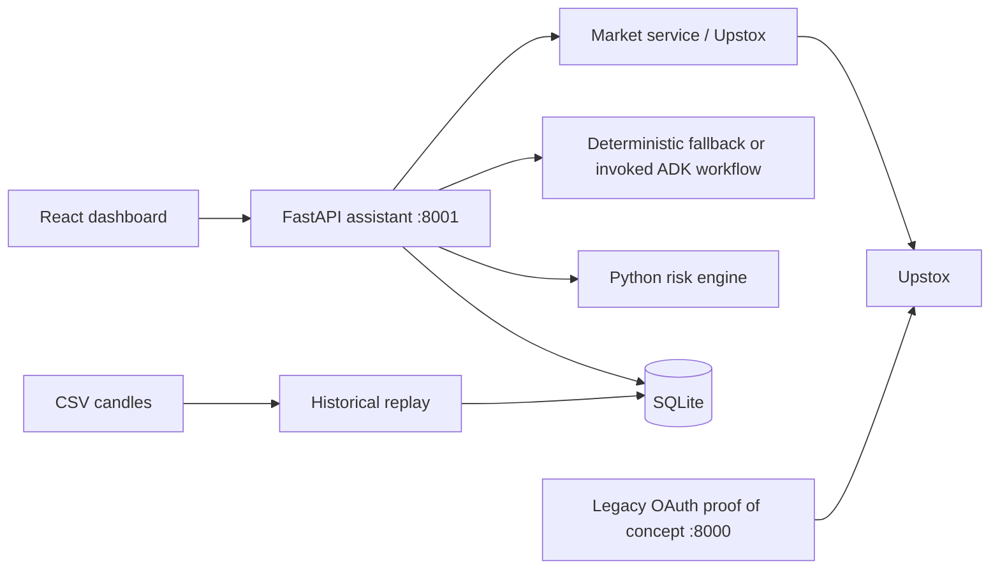
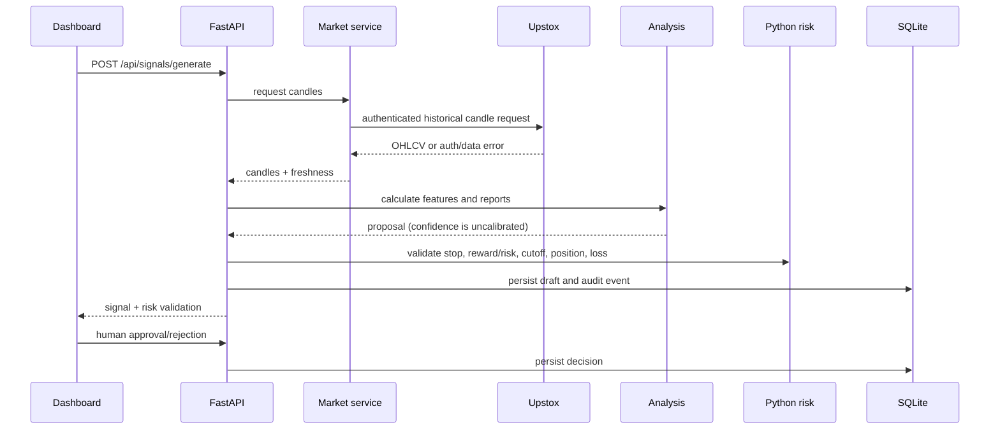

# Architecture and operating flow

## Requirements coverage

The local React + TypeScript + Vite UI and FastAPI API use SQLite for signals, settings, paper positions, audits and backtest results. Upstox remains the sole live data provider. Existing OAuth / quote proof-of-concept code is preserved in `backend/app.py` (port 8000); the assistant API is port 8001. There is no broker order placement or live execution endpoint.

Implemented: quote/candle retrieval, explicit status states, technical features, deterministic fallback, editable prompts, invoked ADK parallel analysts with explicit shared-state handoff to an Orchestrator whose exact JSON Schema contract is included in its prompt and enforced locally by Pydantic, Python risk validation, human approval lifecycle, manual paper journal, analytics, CSV import and deterministic historical replay. Malformed specialist reports are downgraded to insufficient evidence; a malformed final proposal fails closed and can be retried. Live fundamental analysis receives relevant timestamped summaries from an hourly EIA RSS cache; it reports insufficient evidence when no relevant items are cached. Instrument key, expiry, lot size and tick size are not validated by the app and must be checked against current Upstox contract metadata before use. Risk inputs are user-configurable; costs are estimates.

Not currently implemented: Upstox instrument master metadata validation, live paper-position force-close automation, and per-role ADK runtime enable controls. ADK analysis is enabled automatically with a configured API key and `AGENT_MODE=auto`, or explicitly required with `AGENT_MODE=adk`. The optional background scheduler is disabled by default; when enabled with `SCHEDULER_ENABLED=true`, it drafts analysis at `SCHEDULER_INTERVAL_MINUTES` (default 5) during the configured weekday market window. These remain roadmap items.

## Components

## Live analysis flow

## Paper entry / exit

An operator approves a non-expired signal, then manually records a paper entry. The API rechecks the risk gates and one-open-position rule. Exits are also entered manually; net P&L subtracts estimated entry and exit friction. No broker order is sent. The exit cutoff is a policy setting and does not force-close a paper position automatically.

## Backtest flow and methodology

Upload a CSV containing timestamp, open, high, low, close and optional volume. Rows are validated and sorted. The deterministic `ema_rsi` strategy computes each decision using candles through that timestamp and enters at the next candle open. Stop/target checks begin from the entry candle; if both levels are crossed in one OHLC bar, stop is conservatively assumed first. Risk sizing floors quantity to whole lots under the monetary risk budget. Brokerage, taxes, slippage, fixed estimated charges and configured session cutoff are applied. Results and configuration are persisted. This is historical deterministic replay, not live ADK replay. Gaps, partial fills, exchange holidays, exact contract charges, expiry roll, tick rounding and intrabar order are not modeled; results are not predictive.

The separate replay screen starts from a selected timestamp and runs an analysis on that candle. Each user click advances one CSV candle and requests a new ADK historical-only analysis (or the deterministic fallback), with progress, confidence, reports, feature values, and a replay-time risk check. Each invocation receives only the history prefix through its current candle. See [solution architecture replay details](solution-architect.md#step-by-step-historical-replay).

## API status

`GET /api/health` verifies process availability. `GET /api/status` reports `READY`, `STALE_DATA`, `MARKET_CLOSED`, `TOKEN_EXPIRED`, `TOKEN_INVALID` or `DATA_UNAVAILABLE` for current live context. The UI should treat missing live market data as recoverable; backtesting can run without it.

`GET /api/agents/status` reports whether ADK is selected, whether `GOOGLE_API_KEY` was loaded, whether the ADK package is installed, and the selected model—never the key value. Google credentials belong in `backend/.env`; restart the API after changing that file.
