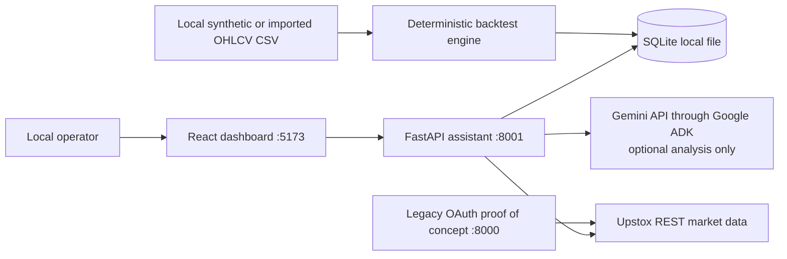
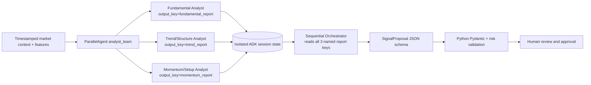

# MCX Crude Oil Mini AI Assistant — Solution Architecture

**Status:** local Windows research application. **Execution:** manual paper only. **Broker order placement:** absent by design.

## 1. Executive overview

This solution combines a React/TypeScript local dashboard, a Python FastAPI service, SQLite persistence, an Upstox market-data adapter, a deterministic Python risk boundary, optional Google ADK analysis, and an offline candle-replay engine. The UI separates **Realtime** market monitoring and signal review from the **Backtest** screen. Realtime displays market readiness, quote timestamps, analysis settings, a review-signal action, generated signal timestamps, paper positions and performance. The application is usable when the market or Upstox is unavailable: live-data state is surfaced independently, while backtests consume a local CSV.

ADK mode is enabled automatically when `AGENT_MODE=auto` and `GOOGLE_API_KEY` is configured. Otherwise the deterministic indicator strategy remains active. In ADK mode, the three analyst agents run in parallel and write schema-constrained reports to named ADK session-state keys. A sequential Orchestrator reads those keys and returns a `SignalProposal`. The proposal is validated by local Pydantic models and the Python risk engine before it can become a draft signal. No agent has tools for trading, approving signals, or changing risk configuration.

## 2. Context and scope



The legacy OAuth proof-of-concept in `backend/app.py` remains separate on port 8000. It shares the local `.env` credential store. The assistant reads the Upstox access token from backend configuration and does not expose it through API responses. The React app does not receive broker credentials.

In scope: live read-only quote/candle access, timestamp/freshness handling, technical features, proposal generation, risk validation, human approval, manual paper journal, analytics, CSV backtests, audit trail, editable agent prompts, and local Windows setup.

Out of scope: order placement, unattended or live execution, automatic paper-position closure, paid news-source integration, and validated instrument-master ingestion. A basic public EIA RSS cache supplies sourced headlines/summaries to live analysis; it is not a complete real-time news service. Historical ADK replay remains isolated from today's fundamental cache to avoid future-data leakage.

## 3. Component responsibilities

| Component | Responsibility | Trust boundary |
|---|---|---|
| `frontend/src` | Quote/status dashboard, signal review, approval, paper journal, CSV backtest UI | No secrets; user interaction only |
| `backend/mcx_ai/main.py` | HTTP API, orchestration entry point, persistence, scheduler | Local service; schema validation at ingress |
| `market.py` | Authenticated Upstox GETs, quote/candle parsing, freshness | External network/data boundary |
| `analysis.py` | Reproducible EMA/RSI/ATR/VWAP/MACD/structure calculations and deterministic fallback | Pure calculations; no authority to execute |
| `adk_agents.py` | Build/run isolated ADK graph; inject each Pydantic JSON Schema into the role prompt and locally validate report and proposal outputs | Untrusted model output; malformed specialist reports become insufficient evidence; invalid final proposals fail closed; no execution tools |
| `risk.py` | Stop distance, target direction, reward/risk, cutoff, one-open-position, daily-loss, estimated costs | Deterministic policy gate; final proposal authority |
| `backtest.py` | CSV validation, no-lookahead replay, risk sizing, friction and session exits | Historical simulation only |
| `storage.py` | SQLite schemas, persistence, settings and audit records | Local disk; no cloud persistence |
| `prompts/*.md` | Versioned role instructions for four agents | Editable instructions; common schemas must remain fixed |

## 4. ADK topology and communication

The runtime graph is explicit; sub-agent availability alone is not treated as sufficient handoff:



Each specialist writes its schema-validated `AgentReport` to a dedicated `output_key`. ADK runs the independent specialists concurrently in one isolated session. The workflow advances to the Orchestrator only after that parallel stage completes. The Orchestrator instruction explicitly interpolates the three report keys, including the fundamental report's `insufficient` status. The final `SignalProposal` is read from `signal_decision`, parsed by Pydantic, and specialist reports are attached to the persisted signal for review.

The model cannot set a risk override, approve itself, or call an order API. Python rejects unsupported direction, missing prices, invalid stop/target geometry, stop distances above the configured cap, poor reward/risk, cutoff violations, an existing open position, and a breached daily-loss cap. Human approval remains a separate required state transition. If ADK fails, returns a missing report, malformed structured output, or an incomplete trade proposal, the API fails closed and creates no signal; it does not silently substitute a model result or approve anything.

**Cost/latency:** ADK mode makes three parallel analyst model calls plus one Orchestrator call per signal. The model and maximum output size are configurable; live calls incur provider latency and potentially billable usage. Deterministic mode makes no model call.

## 5. End-to-end signal sequence

```mermaid
sequenceDiagram
 actor Operator
 participant UI as React UI
 participant API as FastAPI
 participant Market as Upstox adapter
 participant Upstox
 participant ADK as ADK workflow
 participant Risk as Python risk engine
 participant DB as SQLite
 Operator->>UI: Generate review signal
 UI->>API: POST /api/signals/generate
 API->>Market: Fetch current candles
 Market->>Upstox: Authenticated read-only request
 Upstox-->>Market: OHLCV response / auth or data error
 Market-->>API: Parsed candles
 API->>API: Check session and candle freshness; calculate features
 alt ADK enabled and API key configured
  API->>ADK: Timestamped context + features + recent candles
  par Analysts
   ADK->>ADK: Fundamental Analyst -> fundamental_report
   ADK->>ADK: Trend Analyst -> trend_report
   ADK->>ADK: Momentum Analyst -> momentum_report
  end
  ADK->>ADK: Orchestrator reads reports; emits SignalProposal
  ADK-->>API: proposal + three reports
 else Deterministic mode
  API->>API: Rule-based proposal
 end
 API->>Risk: Validate model/rule proposal
 Risk-->>API: Eligibility errors or eligible-for-review
 API->>DB: Persist DRAFT, reports, rationale, expiry, audit event
 API-->>UI: Draft and validations
 Operator->>UI: Approve or reject
 UI->>API: POST /api/signals/{id}/approval
 API->>DB: Persist human decision
```

## 6. Backtesting architecture and sample run

### Step-by-step historical replay

The dashboard's replay panel accepts a selected start date/time, candle interval, stop cap, and monetary risk budget. The backend selects the first CSV candle at or after that time and requires at least 29 earlier candles for indicator warm-up. It analyzes the selected candle immediately. Each **Next candle** request advances one imported row; the feature snapshot and ADK context include only candles through that row. Each step records the candle, timestamp, analysis mode, confidence, recommendation, analyst reports, historical risk check, and progress in the SQLite replay session. When ADK is configured, each step invokes the same three-parallel-analyst plus Orchestrator workflow with a historical-only context; otherwise it runs the deterministic analysis. ADK errors are recorded as insufficient analysis and never silently replaced by deterministic output. A failed step can be retried in place without advancing or duplicating its history position.

Replay risk checks use the candle's historical clock and replay risk parameters. They do not consult today's open paper position or daily loss because replay recommendations are not paper executions. Suggested quantity is a simple stop-risk sizing estimate using the configured multiplier and lot size; contract lot/tick metadata and actual fills are still unverified. The displayed interval is supplied by the user; replay advances by one actual CSV row each click and displays the row timestamp, so missing/gapped bars remain visible to the operator.

The checked-in `data/examples/synthetic_crude_5m.csv` is fully generated, deterministic, and not market data. It contains 360 five-minute OHLCV rows over five synthetic weekdays, with repeated rising/falling regimes. It can be imported from the dashboard or posted to `POST /api/backtests`. The importer also accepts the attached TrainingData-style columns (`Date`, title-case OHLC, `% Change`, `% Change vs Average`, `Volume`), ignores extra derived columns, handles GMT offset display strings, and removes standard thousands separators from numeric cells.

The engine sorts and validates candles, calculates each decision using history available through the decision bar, and enters at the next bar's open. It allows only one simulated position at a time, sizes down to whole configured lots under the stop-risk budget plus estimated friction, checks the stop/target conservatively (stop wins if both are crossed in one bar), exits on session cutoff or before a date boundary, and accounts for estimated brokerage/taxes/slippage/fixed charges. Each run stores its configuration and trade list.

Verified sample invocation from `backend`:

```powershell
@'
from pathlib import Path
from mcx_ai.backtest import parse_csv, run_backtest
bars = parse_csv(Path('../data/examples/synthetic_crude_5m.csv').read_text())
result = run_backtest(bars)
print({k: result[k] for k in ('trade_count','net_pnl','win_rate','profit_factor','max_drawdown','expectancy','total_costs')})
'@ | .\.venv\Scripts\python.exe -
```

Observed with the current default replay inputs at implementation time: **41 trades; net P&L −₹43,648.48; win rate 21.95%; profit factor 0.203; maximum drawdown ₹43,648.48; expectancy −₹1,064.60/trade; estimated costs ₹29,555.38.** These values are a plumbing demonstration on synthetic prices, not a strategy evaluation or market claim. Cost assumptions and the unverified lot size materially affect results. Re-run to reproduce after configuration changes.

Limitations: this replay is deterministic, not ADK; synthetic rows contain no exchange gaps, real spreads, expiry roll, holidays, partial fills, tick rounding, order-book depth, or exact broker contract-note charges. OHLC bars cannot reveal intrabar path. The current engine can still lose beyond intended risk from gaps/slippage; risk sizing is an estimate, not a hard loss guarantee.

## 7. Data and persistence

SQLite stores `settings`, `signals`, `positions`, `audit_log`, and `backtests`. Agent reports and backtest trades/configuration are stored as JSON text associated with local rows. No cloud DB or multi-user isolation is configured. The service is intended for one local operator and binds to loopback using the provided scripts.

Live status distinguishes `READY`, `STALE_DATA`, `MARKET_CLOSED`, `TOKEN_EXPIRED`, `TOKEN_INVALID`, and `DATA_UNAVAILABLE`. Signal generation rejects unavailable, stale, or closed-session inputs. A closed market does not prevent the server starting or CSV replay running.

The instrument key remains unverified. Before treating paper quantities or P&L as contract-accurate, verify the current active expiry, actual contract name, lot size, tick size, and multiplier from Upstox instrument metadata. The fundamental analyst reads timestamped reports from the hourly EIA RSS cache; it still returns insufficient data when no relevant feed items are available or every source is temporarily unavailable and no cache exists. A `NO_TRADE` result with confidence `0` is shown as “Not scored.” Agent/provider failures surface as errors and do not produce a normal persisted realtime signal.

## 8. Configuration and operations

Credentials reside in `backend/.env`; `.env` is excluded from the delivery archive. `backend/.env.example` has placeholders. Relevant controls:

| Key | Meaning |
|---|---|
| `AGENT_MODE=auto` | Use ADK only when `GOOGLE_API_KEY` is configured; otherwise deterministic fallback |
| `AGENT_MODE=adk` | Require ADK and a configured API key; failures stop signal creation |
| `AGENT_MODE=deterministic` | Never call an LLM |
| `GOOGLE_MODEL` | ADK model name |
| `AGENT_OUTPUT_TOKENS` | Bounded generation output, clamped to 128–4096 |
| `SCHEDULER_ENABLED=false` | Optional local draft generation scheduler; disabled by default |
| `SCHEDULER_INTERVAL_MINUTES=5` | Scheduler cadence |
| `UPSTOX_ACCESS_TOKEN` | Read-only quote/candle access token |

The Gemini key is correctly stored as `GOOGLE_API_KEY` in `backend/.env`. The backend reads it on process start. The React frontend does not need a copy. Check `GET /api/agents/status` or the dashboard Analysis configuration card to confirm mode/key-loaded state without returning the secret. Restart the backend after editing `.env`.

Start with `./scripts/run.ps1`. Assistant API is `http://127.0.0.1:8001`, frontend `http://localhost:5173`, legacy OAuth POC `http://127.0.0.1:8000`. API docs: `/docs`. Health and market-state endpoints are `/api/health` and `/api/status`.

## 9. Quality attributes and controls

- **Safety:** no order routes/tools; independent deterministic risk gate; human approval; fail-closed ADK schema/error handling.
- **Privacy:** local SQLite and local `.env`; API keys never sent to the browser or returned in status payloads. Configured ADK requests do transmit the supplied market context/candles to the configured model provider.
- **Availability:** API process starts without Upstox credentials; explicit state surfaces market/auth/data outages; offline CSV backtest does not use Upstox.
- **Reproducibility:** fixed CSV, replay configuration, deterministic indicator functions, persisted result and trade details.
- **Auditability:** signal lifecycle, settings updates, paper entries/exits, backtests, and scheduled analysis failures recorded in SQLite audit log.
- **Concurrency:** the optional scheduler is a local daemon thread; SQLite and this single-user app are not designed for multi-instance deployment.

## 10. Verification and known limitations

Backend tests verify the ADK graph's stages and `output_key` report handoff using a mocked ADK runner, signal endpoint routing into the ADK analyzer, CSV/replay determinism, risk sizing, cost accounting, session boundary/cutoff, schema validation, and status classification. The local backend currently reports the Google key as loaded and ADK selected in auto mode. No live Gemini inference was triggered during development tests; production response quality, quotas, billing, and service availability therefore remain unverified.

Known follow-up work: upgrade legacy ADK workflow classes to the newer Workflow graph API once ADK's LLM-agent-as-workflow-node support is stable; configure runtime role toggles; validate Upstox contract metadata; add exact exchange/broker transaction-charge model and tick rounding; and implement a safe paper-position cutoff workflow that has an available, fresh mark price.
